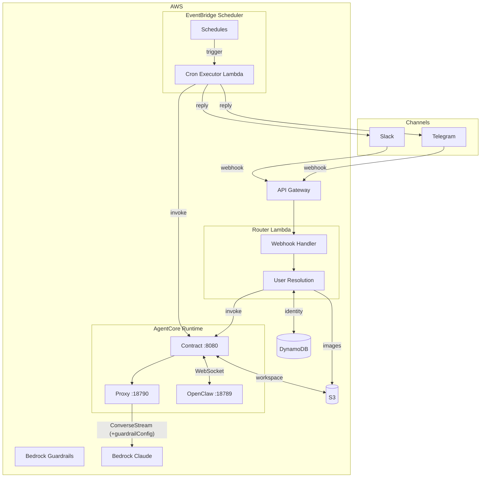
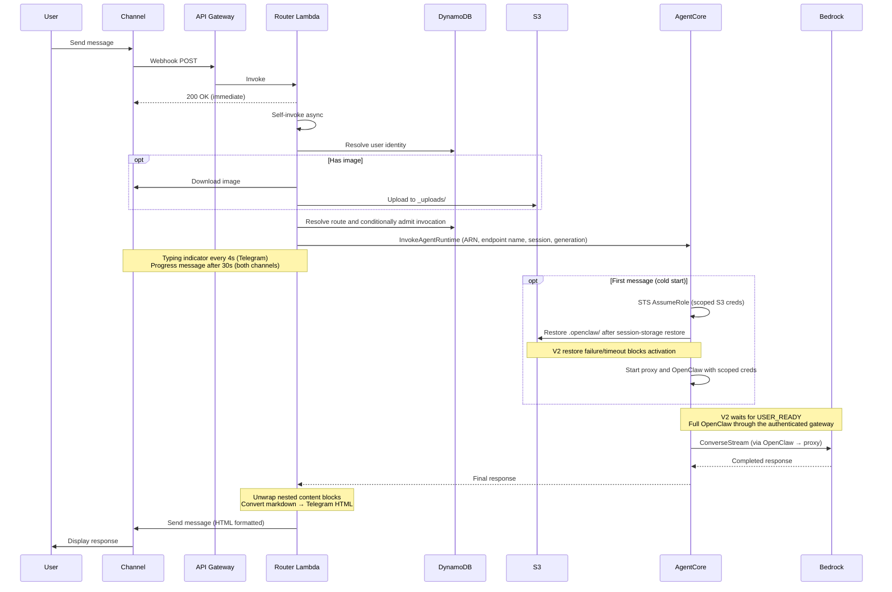
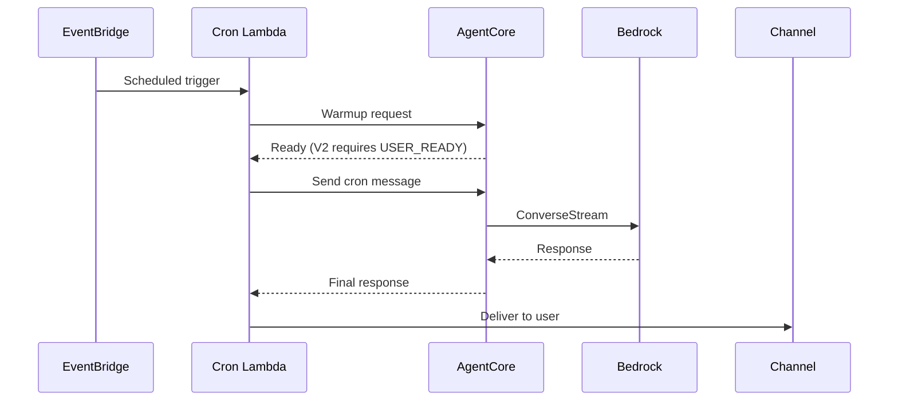
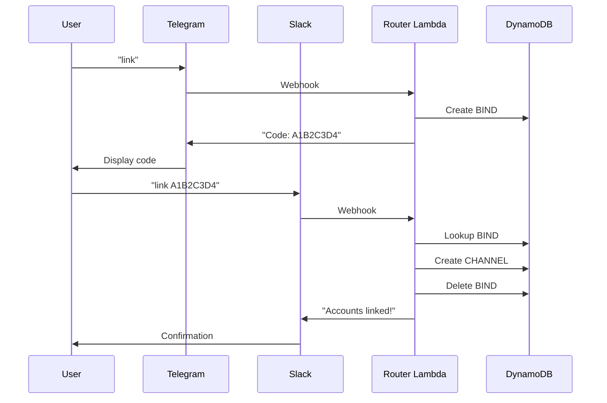
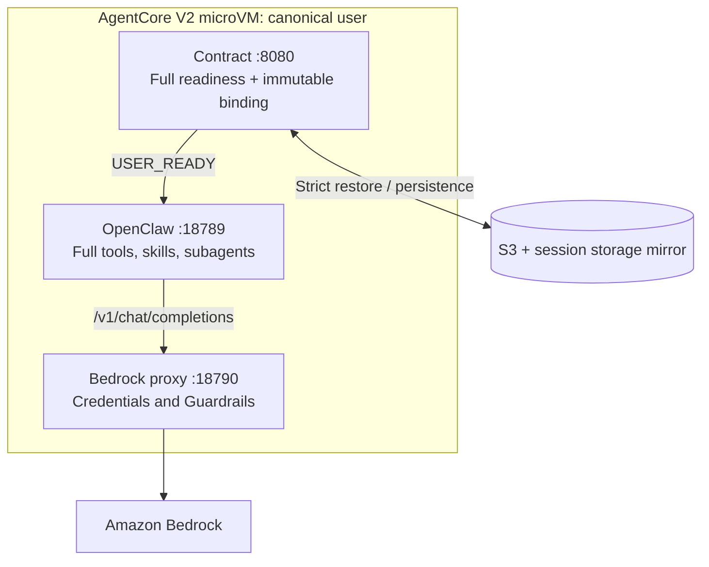
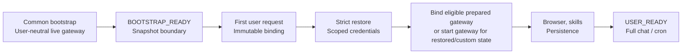

# Detailed Technical Architecture

This document provides a detailed technical view of the OpenClaw on AgentCore architecture. For a high-level overview, see the [README](../README.md#architecture).

AgentCore Runtime V2 is the only platform. See the [AgentCore Runtime V2 runbook](runtime-v2.md) for snapshot eligibility, user readiness, deployment and migration limits.

## Component Diagram



## Component Details

| Component | Port | Purpose |
|---|---|---|
| **Contract Server** | 8080 | AgentCore HTTP contract (`/ping`, `/invocations`); V2 bootstrap/activation and full-gateway admission |
| **Bedrock Proxy** | 18790 | OpenAI-compatible API → Bedrock ConverseStream, Cognito identity, multimodal image handling |
| **OpenClaw Gateway** | 18789 | Headless OpenClaw `2026.9.5` with full tools and ClawHub skills; V2 verifies `/startupz`, protocol-4 token handshake and cached `last-heartbeat` RPC |
| **Shared routing layer** | — | Conditional Router/Cron admission on one AgentCore Runtime ARN, endpoint name, session ID and generation |

## Data Flow

### Message Flow (User → Agent → Response)



### Cron Job Flow (Scheduled Task)



### Cross-Channel Account Linking

An unregistered channel can become an alias of the canonical V2 user. Its caller/delivery identity stays separate from SESSION.actorId. An actor already owned by another canonical user cannot transfer; this is not an account merge.



## Container Internals

V2 completes strict activation before full OpenClaw handles chat or cron.



The OpenAI-compatible `/v1/chat/completions` protocol is independent of AgentCore Runtime platform V2. File, scheduling, ClawHub and API key skills remain in full OpenClaw; Browser and Gateway integrations retain their readiness checks.

### Two-Phase Startup



See the [AgentCore Runtime V2 lifecycle contract](runtime-v2.md#lifecycle-and-compatibility) for snapshot eligibility, readiness checks and restore failure handling.

Deployment warmup is a billed real chat with an isolated synthetic actor/session after AgentCore Runtime and endpoint readback. It requires full OpenClaw completion, USER_READY and matching immutable binding; see the [warmup contract](runtime-v2.md#post-deployment-warmup). It neither warms real-user state nor establishes first-reply latency.

## S3 Bucket Structure

```
s3://openclaw-user-files-{account}-{region}/
├── telegram_123456789/           # User namespace (channel_id)
│   ├── .openclaw/                 # Workspace (synced on init/shutdown)
│   │   ├── MEMORY.md
│   │   ├── USER.md
│   │   └── ...
│   ├── _uploads/                  # Image uploads (from Router Lambda)
│   │   ├── img_1709012345_a1b2.jpeg
│   │   └── ...
│   └── documents/                 # User files (via s3-user-files skill)
│       └── notes.md
├── slack_U12345678/
│   └── ...
└── ...
```

## DynamoDB Schema

**Table: `openclaw-identity`**

| PK | SK | Purpose | TTL |
|---|---|---|---|
| `CHANNEL#telegram:123` | `PROFILE` | Channel → userId mapping | - |
| `ACTOR#telegram:123` | `OWNER` | Durable userId, actorId, platformVersion and ownerGeneration | - |
| `USER#user_abc` | `PROFILE` | User profile | - |
| `USER#user_abc` | `CHANNEL#telegram:123` | User's bound channels | - |
| `USER#user_abc` | `SESSION` | Route tuple, platform, admission status/count/tokens; V2 actor binding | - |
| `USER#user_abc` | `CRON#reminder-1` | Cron schedule metadata | - |
| `BIND#ABC123` | `BIND` | Cross-channel bind code | 10 min |
| `ALLOW#telegram:123` | `ALLOW` | User allowlist entry | - |

Route fields are `runtimeArn`, `endpointName`, `sessionId`, `generation`, `platformVersion`, `routeStatus`, `inFlight` and `activeAdmissions`; V2 also pins `actorId`, AgentCore Runtime version, image digest and configuration hash. V2 first registrations transact five absent identity/session/OWNER records. V2 starts at generation 1. Missing OWNER requires a strongly consistent paginated legacy Scan; retained provenance or uncertainty blocks fresh enrollment. OWNER has no TTL. A missing V2-enrolled SESSION/profile fails closed. V1 and incomplete routes fail closed; there is no default AgentCore Runtime fallback.

Admission adds a unique token and increments the count; release removes only that token once. Unknown transport/deadline outcomes retain admission, and freeze requires zero count plus no tokens. Cron's bounded calls reserve 6 seconds for release, plus 15 seconds for delivery on business calls. Conditional admission does not fence S3 writes, stop processes or prove drain. Unregistered channel aliases may link to the canonical V2 route; transfer from another canonical owner and existing-user migration are not implemented. See the [runbook](runtime-v2.md) for reconciliation limits.

## Security Architecture

See [security.md](security.md) for the complete security architecture.

**Key controls:**
- VPC isolation with 7 VPC endpoints
- Webhook signature validation (Telegram + Slack)
- Per-user microVM isolation
- STS session-scoped credentials (per-user S3 namespace + DynamoDB record restriction)
- KMS encryption at rest
- Security group egress restricted to HTTPS (TCP 443) only
- OpenClaw `read` tool denied (prevents credential access); `exec` allowed for skill management (STS-scoped); proxy bound to loopback
- Least-privilege IAM with cdk-nag enforcement
