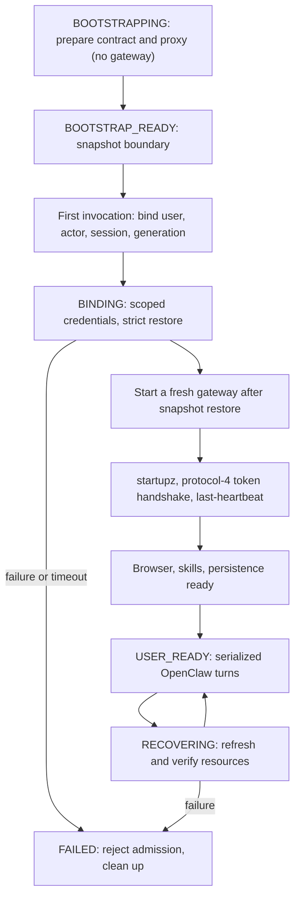

# OpenClaw on AgentCore — Solution Architecture

AgentCore Runtime V2 separates user-free snapshot preparation from strict activation. Chat and cron wait for full OpenClaw readiness. See the [AgentCore Runtime V2 runbook](runtime-v2.md) for manifest-based deployment, immutable endpoints and migration limits.

## High-Level Architecture

```
                                                      +---------------------------+
                                                      |        End Users          |
                                                      |    Telegram     Slack     |
                                                      +--+---------------+-------+
                                                         |               |
                                              (webhook HTTPS over internet)
                                                         |               |
+--------------------------------------------------------+---------------+-------------------+
|  AWS Account                                                                               |
|                                                                                            |
|  +----------------------------------------------+                                         |
|  |  API Gateway HTTP API                        |                                         |
|  |  (openclaw-router)                           |                                         |
|  |                                              |                                         |
|  |  POST /webhook/telegram  --> Lambda          |                                         |
|  |  POST /webhook/slack     --> Lambda          |                                         |
|  |  GET  /health            --> Lambda          |                                         |
|  |  (all other paths --> 404, no Lambda invoke) |                                         |
|  |                                              |                                         |
|  |  Throttling: burst 50, sustained 100 req/s   |                                         |
|  +----------------------+-----------------------+                                         |
|                         |                                                                  |
|  +----------------------v-----------------------+                                         |
|  |  Router Lambda (openclaw-router)             |                                         |
|  |                                              |                                         |
|  |  1. Validate webhook signature               |                                         |
|  |     - Telegram: X-Telegram-Bot-Api-Secret-   |                                         |
|  |       Token header                           |                                         |
|  |     - Slack: X-Slack-Signature HMAC-SHA256   |                                         |
|  |  2. Self-invoke async (return 200 to caller) |                                         |
|  |  3. Resolve user in DynamoDB identity table  |                                         |
|  |  4. Get/create per-user AgentCore session    |                                         |
|  |  5. InvokeAgentRuntime(sessionId=per-user)   |                                         |
|  |  6. Send response back to channel API        |                                         |
|  +----------------------+-----------------------+                                         |
|                         |                                                                  |
|          +--------------+--------------+                                                   |
|          |                             |                                                   |
|  +-------v--------+          +--------v---------+                                         |
|  | DynamoDB       |          | Secrets Manager   |                                         |
|  | (identity)     |          | - gateway-token   |                                         |
|  |                |          | - webhook-secret  |                                         |
|  | CHANNEL# items |          | - cognito-password|                                         |
|  | USER# items    |          | - channels/*      |                                         |
|  | SESSION items  |          +-------------------+                                         |
|  | BIND# items    |                                                                        |
|  | ALLOW# items   |                                                                        |
|  | CRON# items    |                                                                        |
|  +----------------+                                                                        |
|                         |                                                                  |
|  +---------------------------------------------------+                                    |
|  |  VPC (10.0.0.0/16)                                |                                    |
|  |  +----------------------------------------------+ |                                    |
|  |  |  Public Subnets (2 AZ)                       | |                                    |
|  |  |  +----------------+  +---------------------+ | |                                    |
|  |  |  | NAT Gateway    |  | Internet Gateway    | | |                                    |
|  |  |  +-------+--------+  +----------+----------+ | |                                    |
|  |  +----------|-------------------------|---------+ |                                    |
|  |  |          v                         |           |                                    |
|  |  |  Private Subnets (2 AZ)            |           |                                    |
|  |  |                                                |                                    |
|  |  |  +------------------------------------------+  |                                    |
|  |  |  |  AgentCore Runtime Container (ARM64)     |  |                                    |
|  |  |  |  (per-user microVM — managed serverless) |  |                                    |
|  |  |  |                                          |  |                                    |
|  |  |  |  +--------------+  +-----------------+   |  |                                    |
|  |  |  |  | agentcore-   |  | OpenClaw        |   |  |                                    |
|  |  |  |  | contract.js  |  | Gateway         |   |  |                                    |
|  |  |  |  | (port 8080)  |  | (port 18789)    |   |  |                                    |
|  |  |  |  | - /ping      |  | - headless mode |   |  |                                    |
|  |  |  |  | /invocations|  | - no channels   |   |  |                                    |
|  |  |  |  | - WS bridge  |  | - tools & skills|   |  |                                    |
|  |  |  |  +--------------+  +--------+--------+   |  |                                    |
|  |  |  |                             |            |  |                                    |
|  |  |  |                    +--------v--------+   |  |                                    |
|  |  |  |                    | agentcore-      |   |  |                                    |
|  |  |  |                    | proxy.js        |   |  |                                    |
|  |  |  |                    | (port 18790)    |   |  |                                    |
|  |  |  |                    | - OpenAI compat |   |  |                                    |
|  |  |  |                    | - Converse API  |   |  |                                    |
|  |  |  |                    | - SSE streaming |   |  |                                    |
|  |  |  |                    +--------+--------+   |  |                                    |
|  |  |  +---------------------|--------------------+  |                                    |
|  |  |                        |                       |                                    |
|  |  |  +---------------------v--------------------+  |                                    |
|  |  |  |  VPC Endpoints (Interface)               |  |                                    |
|  |  |  |  - bedrock-runtime    - ecr.api          |  |                                    |
|  |  |  |  - secretsmanager     - ecr.dkr          |  |                                    |
|  |  |  |  - logs               - monitoring       |  |                                    |
|  |  |  |  - ssm                                   |  |                                    |
|  |  |  |  + S3 Gateway Endpoint                   |  |                                    |
|  |  |  +------------------------------------------+  |                                    |
|  |  +------------------------------------------------+                                    |
|  |                            |                                                            |
|  |         +------------------+------------------+                                         |
|  |         |                                     |                                         |
|  |  +------v-----------+               +---------v----------+                              |
|  |  | Amazon Bedrock   |               | S3 User Files      |                              |
|  |  | ConverseStream   |               | Bucket             |                              |
|  |  | API              |               | - {ns}/.openclaw/  |                              |
|  |  | Bedrock model   |               | - {ns}/files/      |                              |
|  |  +------------------+               +--------------------+                              |
|  |                                                                                         |
+--+-----------------------------------------------------------------------------------------+
```

## Per-User Session Lifecycle

Router and Cron resolve the same `(runtime ARN, endpoint name, session ID, generation)` from the user's `SESSION` record. V1 and incomplete records fail closed without a default AgentCore Runtime. First registration transacts identity/session records and a durable actor OWNER with no TTL. Missing ownership requires paginated legacy reconciliation; an existing user's missing session is never enrollment evidence. Missing V2-enrolled sessions fail closed. Conditional admission uses a unique token per invocation and retains uncertain outcomes for reconciliation. V2 pins the actor namespace and release.

V2 lifecycle:



Snapshot eligibility and full readiness follow the [AgentCore Runtime V2 lifecycle contract](runtime-v2.md#lifecycle-and-compatibility). V2 never invokes the lightweight agent or replays an uncertain turn through another engine. `last-heartbeat` reads cached memory; gateway verification alone is not user readiness. Configured Browser sessions require actual `READY` status before readiness and every turn. Cleanup does not establish a verified checkpoint or stopped-session migration gate.

Authorized links retain the canonical storage actor and saved V2 route while separately authorizing the caller and delivery target. Existing-user migration and automatic rollback are not implemented. See the [runbook](runtime-v2.md).

## Container Internal Architecture

V2 uses the ports, proxy and OpenClaw `2026.9.5` shown below, with the readiness and strict-restore barriers above. SQLite stays on local disk and is mirrored to `/mnt/workspace/.openclaw/`, with S3 backups.

```
+-----------------------------------------------------------------------+
|  AgentCore Runtime Container (node:24-slim, ARM64, per-user)          |
|                                                                       |
|  entrypoint.sh starts contract server and prepares gateway modules:                    |
|                                                                       |
|  agentcore-contract.js (port 8080)         <-- MUST START FIRST      |
|    |-- GET /ping -> {"status":"Healthy"}   (only after preparation acknowledgement)  |
|    |-- POST /invocations {action:"chat"}   (waits for USER_READY)      |
|    |-- POST /invocations {action:"status"} (health info)             |
|    |                                                                  |
|    |-- On first bound request (strict activation):                                    |
|    |   1. Fetch secrets from Secrets Manager                         |
|    |   2. Restore .openclaw/ from S3 (workspace-sync.js)             |
|    |   3. Start agentcore-proxy.js (port 18790)                      |
|    |   4. Write headless OpenClaw config (no channels)               |
|    |   5. Activate prepared gateway; verify Browser and readiness                       |
|    |   6. Start periodic workspace saves                              |
|    |                                                                  |
|    |-- On subsequent chats:                                          |
|    |   WebSocket bridge to OpenClaw:                                 |
|    |   connect -> auth(token) -> chat.send -> deltas -> final        |
|    |                                                                  |
|    |-- On SIGTERM:                                                   |
|        Drain credentials -> flush state and stop children -> cleanup                |
|                                                                       |
|  agentcore-proxy.js (port 18790)                                      |
|    |-- POST /v1/chat/completions -> Bedrock ConverseStream            |
|    |-- GET /v1/models -> available models                             |
|    |-- GET /health -> proxy status                                    |
|    |-- Cognito auto-provisioning (HMAC passwords)                     |
|    |-- Per-user workspace files (AGENTS.md, SOUL.md, etc.)            |
|                                                                       |
|  OpenClaw Gateway (port 18789) — headless mode                        |
|    |-- No channel connections (messages bridged via WebSocket)         |
|    |-- Full tool profile (web, filesystem, runtime, sessions, etc.)   |
|    |-- 4 custom skills (s3-user-files, eventbridge-cron,              |
|    |       clawhub-manage, api-keys)                                  |
|                                                                       |
|  NODE_OPTIONS: --dns-result-order=ipv4first                           |
|                --no-network-family-autoselection                       |
|                -r /app/force-ipv4.js                                  |
+-----------------------------------------------------------------------+
```

## Observability Pipeline

```
+------------------+     +--------------------+     +------------------+
| Amazon Bedrock   |     | CloudWatch Logs    |     | Lambda           |
| ConverseStream   |---->| /aws/bedrock/      |---->| token-metrics    |
| (invocations)    |     | invocation-logs    |     | processor        |
+------------------+     +--------------------+     +--------+---------+
                                                             |
                                              +--------------+--------------+
                                              |                             |
                                     +--------v--------+          +--------v--------+
                                     | DynamoDB        |          | CloudWatch      |
                                     | (single-table)  |          | Custom Metrics  |
                                     |                 |          | OpenClaw/       |
                                     | PK: USER#id     |          | TokenUsage      |
                                     | SK: DATE#...    |          |                 |
                                     | GSI1: CHANNEL#  |          | - InputTokens   |
                                     | GSI2: MODEL#    |          | - OutputTokens  |
                                     | GSI3: DATE/COST |          | - TotalTokens   |
                                     | TTL: 90 days    |          | - EstCostUSD    |
                                     +-----------------+          +--------+--------+
                                                                           |
                                                                  +--------v--------+
                                                                  | CloudWatch      |
                                                                  | Dashboards      |
                                                                  | + Alarms        |
                                                                  |                 |
                                                                  | - Operations    |
                                                                  | - Token         |
                                                                  |   Analytics     |
                                                                  | - Budget alarms |
                                                                  | - Anomaly det.  |
                                                                  +---------+-------+
                                                                            |
                                                                   +--------v--------+
                                                                   | SNS Topic       |
                                                                   | (alarm notif.)  |
                                                                   +-----------------+
```

## Identity Flow

```
  Telegram user sends message
         |
         v
  API Gateway -> Router Lambda
         |
         v
  Extract channel user ID (e.g. "telegram:123456789")
         |
         v
  Strong DynamoDB lookup: CHANNEL#telegram:123456789 / PROFILE
         |
         +-- Missing: read durable ACTOR#telegram:123456789 / OWNER
         |   -> OWNER absent: paginated legacy ownership reconciliation
         |   -> Owner/provenance, ambiguity, error or scan limit: fail closed
         |   -> Proven new: user_<first 16 hex of SHA256(actorId)>
         |      Conditional transaction: all five records must be absent
         |      CHANNEL mapping + USER profile + SESSION
         |      + USER channel back-reference + durable OWNER (no TTL)
         |   -> Transaction race: read authoritative winning CHANNEL mapping
         +-- Found: get existing userId
         |
         v
  Resolve SESSION runtime ARN, endpoint, session and generation
  Missing V2-enrolled profile/session: fail closed
         |
         v
  Conditional admission token -> InvokeAgentRuntime(resolved route)
         |
         v
  Container starts -> agentcore-proxy.js
         |
         v
  USER_ID env var set by contract server (e.g. "telegram:123456789")
         |
         v
  derivePassword(actorId) = HMAC-SHA256(secret, actorId).slice(0, 32)
         |
         +-- Cognito AdminGetUser (check if exists)
         |      |
         |      +-- Not found: AdminCreateUser + AdminSetUserPassword
         |      +-- Found: continue
         |
         v
  AdminInitiateAuth (ADMIN_USER_PASSWORD_AUTH)
         |
         v
  JWT IdToken (cached per user, 60s early refresh)
         |
         v
  Bedrock ConverseStream call with user-specific workspace context
```

## Cross-Channel Account Linking

Authorized links retain the canonical V2 actor and route. A second channel must not belong to another owner. Bind codes carry route generation/session evidence; stale codes are rejected.

```
  User on Telegram: "link"
         |
         v
  Router Lambda generates a 16-char random bind code (1:1 chats only)
  Stores in DynamoDB: BIND#A1B2C3D4 -> userId (10 min TTL)
         |
         v
  Bot replies: "Your link code is A1B2C3D4 (valid 10 min)"

  User on Slack: "link A1B2C3D4"
         |
         v
  Router Lambda looks up BIND#A1B2C3D4
  Finds userId from Telegram
         |
         v
  Creates CHANNEL#slack:U12345 -> same userId
  Creates USER#userId CHANNEL#slack:U12345 record
  Deletes bind code
         |
         v
  Both channels now route to same user, session, and workspace
```

## CDK Stack Dependencies

CDK creates the foundation and Lambda stacks. `scripts/runtime_deploy.py` deploys with explicit `platformVersion`, verifies version/endpoint and records image/configuration hashes. V2 custom endpoints are immutable through the controller. Phase 1 can run without a manifest. Phase 3 requires `runtime_manifest` with verified V2 readback and full-gateway warmup before configuring invocation permissions and new registrations. The default SDK manifest is `.runtime/runtime-v2.json`; endpoints start at `release_1`. Deployment does not migrate existing routes.

```
  OpenClawVpc ─────────────┐
                            │
  OpenClawSecurity ─────────┤
                            │
  OpenClawGuardrails ───────┤  (Bedrock content filtering)
                            │
                    ┌───────v───────┐
                    │ OpenClawAgent │
                    │ Core          │
                    └───────┬───────┘
                            │
              ┌─────────────┼─────────────┐
              │             │             │
      ┌───────v───────┐     │     ┌───────v───────┐
      │ OpenClawRouter│     │     │ OpenClawCron  │
      └───────────────┘     │     └───────────────┘
                            │
  OpenClawObservability ────┤
                            │
                    ┌───────v───────┐
                    │ OpenClawToken │
                    │ Monitoring    │
                    └───────────────┘
```

## Security Controls

| Layer | Control | Details |
|---|---|---|
| API Gateway | Explicit routes | Only `/webhook/telegram`, `/webhook/slack`, `/health` — all others 404 |
| API Gateway | Throttling | Burst: 50, sustained: 100 req/s |
| Webhook | Telegram validation | `X-Telegram-Bot-Api-Secret-Token` header against Secrets Manager secret |
| Webhook | Slack validation | `X-Slack-Signature` HMAC-SHA256 with 5-minute replay window |
| Network | VPC + private subnets | Container runs in private subnets, egress via NAT |
| Network | SG egress HTTPS only | Container outbound traffic restricted to TCP 443 |
| Network | VPC endpoints (7) | Bedrock, ECR, Secrets Manager, Logs, Metrics, SSM, S3 |
| Encryption | KMS CMK | All data encrypted with customer-managed key (S3, DynamoDB, SNS, CloudTrail, Secrets Manager) |
| Secrets | Secrets Manager | 7 secrets: gateway token, webhook secret, cognito HMAC, 4 channel tokens |
| Identity | DynamoDB | Channel-to-user mapping, cross-channel binding, session management |
| Identity | Cognito User Pool | Auto-provisioned users with HMAC-derived passwords |
| IAM | Least privilege | cdk-nag AwsSolutions checks enforced at synth |
| Storage | S3 encryption | KMS-encrypted user files bucket, SSL enforced, public access blocked |
| Audit | CloudTrail | API call logging with S3 storage and file validation |
| Monitoring | CloudWatch alarms | Error rates, latency, throttles, budget thresholds |
| Container | Tool deny list | `read` tool blocked (prevents credential access); `exec` allowed for skill management (STS-scoped); proxy on loopback only |
| Content | Bedrock Guardrails | Content filters (HATE, INSULTS, SEXUAL, VIOLENCE, MISCONDUCT, PROMPT_ATTACK), 6 topic denials, PII redaction (10 entity types), word filters, custom regex. Injected via `guardrailConfig` on every ConverseStream call |
| Cost | Token budgets | Daily token/cost alarms with anomaly detection |
