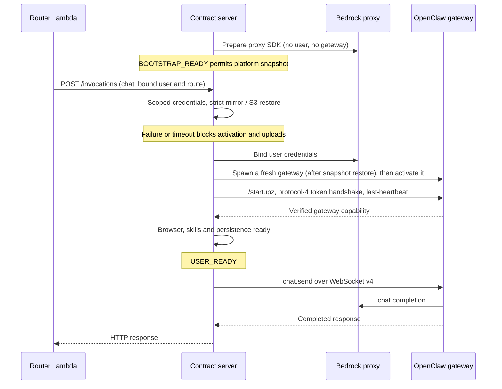

# How It Works

Reference for how the deployment behaves at runtime. Moved out of the [README](../README.md); the README keeps a summary. For diagrams and data flows see [architecture-detailed.md](architecture-detailed.md).

The image supports only AgentCore Runtime V2. See the [AgentCore Runtime V2 runbook](runtime-v2.md) for snapshot eligibility, activation, deployment and migration limits.

## Components

| Component | What it is | Code |
|---|---|---|
| API Gateway HTTP API | Routes `POST /webhook/{telegram,slack,feishu}` and `GET /health`; throttled (burst 50, rate 100) | `stacks/router_stack.py` |
| Router Lambda | Webhook validation, identity resolution, image upload, `InvokeAgentRuntime`, reply delivery, typing/progress notices | `lambda/router/index.py` |
| DynamoDB `openclaw-identity` | Users, channel bindings, sessions, allowlist, link codes, `CRON#` records | `stacks/router_stack.py` |
| Contract server | AgentCore HTTP contract on port 8080 (`/ping`, `/invocations`); per-user init, state layout, gateway spawn, WebSocket bridge, best-effort SIGTERM flush | `bridge/agentcore-contract.js` |
| V2 lifecycle | User-free bootstrap, strict restore, immutable binding, serialized full-gateway turns and failure cleanup | `bridge/runtime-lifecycle.js`, `bridge/gateway-lifecycle.js` |
| Shared route resolver | Router/Cron resolve the same AgentCore Runtime ARN, endpoint name, session and generation, with conditional admission | `lambda/shared/python/runtime_routing.py` |
| OpenClaw gateway | `openclaw@2026.9.5` on `node:24-slim`, gateway protocol v4, `gateway-client`/`backend` identity, 5 pinned ClawHub skills + 4 custom skills from `/skills` | `bridge/Dockerfile`, `bridge/skills/` |
| Bedrock proxy | OpenAI-compatible endpoint on port 18790 → Bedrock `ConverseStream`; multimodal images, sub-agent model routing, per-user Cognito JWT | `bridge/agentcore-proxy.js` |
| Local disk `~/.openclaw` | Authoritative OpenClaw state (SQLite sessions + workspace); the NFS mount cannot hold SQLite locks or hard links | `bridge/state-storage.js` |
| Session storage `/mnt/workspace` | AgentCore managed session storage; mirror of the state dir, restored before user readiness | `bridge/state-storage.js`, `scripts/deploy.sh` |
| S3 user-files bucket | Per-user files, image uploads, screenshots, and `~/.openclaw` snapshots (SQLite via online backup). Versioned; noncurrent versions expire after 30 days (the newest 3 per key are kept) and incomplete multipart uploads are aborted after 7 days | `stacks/agentcore_stack.py`, `bridge/workspace-sync.js` |
| STS scoped credentials | Execution role re-assumed with a session policy limiting S3, DynamoDB, Secrets Manager and Scheduler to the user's namespace | `bridge/scoped-credentials.js` |
| Cognito User Pool | Per-user Cognito user with an HMAC-derived password; the proxy acquires and caches an ID token per user. With `enable_gateway: true` the contract server mints the same user's **access** token as the bearer for the Gateway MCP server | `stacks/security_stack.py`, `bridge/agentcore-proxy.js`, `bridge/cognito-token.js` |
| Secrets Manager | `openclaw/gateway-token`, `openclaw/channels/*`, `openclaw/webhook-secret`, `openclaw/cognito-password-secret`, per-user `openclaw/user/{ns}/*` | `stacks/security_stack.py`, `bridge/skills/api-keys/` |
| KMS CMK | Encrypts S3, DynamoDB, SNS and Secrets Manager | `stacks/security_stack.py` |
| EventBridge Scheduler + Cron Lambda | Schedule group `openclaw-cron`; `openclaw-cron-executor` warms the session, sends the `cron` action and posts the reply to Telegram, Slack or Feishu | `stacks/cron_stack.py`, `lambda/cron/index.py`, `bridge/skills/eventbridge-cron/` |
| Token monitoring | Bedrock invocation logs → CloudWatch subscription → `token_metrics` Lambda → DynamoDB (3 GSIs) + custom metrics, dashboards, budget alarms, SNS | `stacks/observability_stack.py`, `stacks/token_monitoring_stack.py`, `lambda/token_metrics/index.py` |
| Bedrock Guardrails (optional) | `CfnGuardrail` + version; see [Security](../README.md#security) | `stacks/guardrails_stack.py` |
| AgentCore Gateway (optional, prototype) | `enable_gateway: false` by default. When on: MCP Gateway `openclaw-tools` with a Cognito JWT authorizer, a REQUEST interceptor Lambda and two Lambda targets (`user-files`, `schedules`) that serve the file and schedule tools as typed MCP tools; see [AgentCore Gateway MCP tools](#agentcore-gateway-mcp-tools-prototype) | `stacks/gateway_stack.py`, `lambda/gateway_tools/`, `bridge/gateway-mcp.js` |
| AgentCore Browser (optional) | `CfnBrowserCustom` in the VPC, used by the `agentcore-browser` skill | `stacks/agentcore_stack.py`, `bridge/skills/agentcore-browser/` |

## CDK Stacks

| Stack | Resources | Dependencies |
|---|---|---|
| **OpenClawVpc** | VPC (2 AZ), private/public subnets, NAT, 7 interface endpoints (Bedrock Runtime, SSM, ECR API/Docker, Secrets Manager, CloudWatch Logs/Monitoring) + S3 gateway endpoint, flow logs | None |
| **OpenClawSecurity** | KMS CMK, Secrets Manager (8 secrets: gateway token, 5 channel tokens, webhook secret, Cognito password secret), Cognito User Pool + client, optional CloudTrail | None |
| **OpenClawGuardrails** | CfnGuardrail (content filters, topic denial, PII, word filters, regex), CfnGuardrailVersion | Security |
| **OpenClawAgentCore** | Execution role, security group, S3 user-files bucket, optional `CfnBrowserCustom`. Phase 2 resolves/creates ECR and uses the SDK controller for AgentCore Runtime deployment. The verified `runtime_manifest` configures V2 invocation/enrollment; no manifest means foundation only | Vpc, Security, Guardrails |
| **OpenClawRouter** | Lambda, API Gateway HTTP API (`/webhook/telegram`, `/webhook/slack`, `/webhook/feishu`, `/health`; throttling), DynamoDB `openclaw-identity` table | AgentCore, Security |
| **OpenClawObservability** | Operations dashboard, alarms (errors, latency, throttles), SNS topic, Bedrock invocation logging | Security |
| **OpenClawTokenMonitoring** | DynamoDB (single-table, 3 GSIs), Lambda processor, analytics dashboard | Observability, Security |
| **OpenClawCron** | EventBridge Scheduler group `openclaw-cron`, Cron executor Lambda `openclaw-cron-executor`, Scheduler IAM role | AgentCore, Security (identity table referenced by name) |
| **OpenClawGateway** (opt-in, `enable_gateway`) | Prototype: AgentCore Gateway (MCP, Cognito JWT authorizer), REQUEST interceptor Lambda, two Lambda MCP targets for per-user files and schedules. Not instantiated with the default `enable_gateway: false`; see [docs/gateway-mcp-tools.md](gateway-mcp-tools.md) | Security |

## First-Message Startup Diagram

Every session starts a fresh OpenClaw gateway after the snapshot restore, so no key or id is shared between users ([why](runtime-v2.md#no-pre-snapshot-gateway)); restored state is applied strictly before activation. See the [AgentCore Runtime V2 lifecycle contract](runtime-v2.md#lifecycle-and-compatibility).



First-reply latency cannot be inferred from this untimed diagram.

## Why S3 Workspace Sync?

AgentCore microVMs are ephemeral — they're destroyed when idle. OpenClaw stores conversation history (per-agent SQLite databases since 2.0), user profiles, and agent configuration in the `~/.openclaw/` directory. **S3-backed workspace sync** restores this directory on session start and then uploads each changed file a few seconds after it changes (debounced 5 s, at most 30 s after the first change; when only SQLite databases changed, their snapshots go up at most every 5 min, or every 10 min for databases over 10 MB). A full save also runs every 5 min (30 min when session storage is the primary store). AgentCore gives no reliable shutdown window (on staging the container was gone well under 5 s after `SIGTERM`, and idle stops sent no `SIGTERM` at all), so the `SIGTERM` save is best effort, not the guarantee. Each `*.sqlite` file is uploaded as a consistent point-in-time snapshot (node:sqlite online backup), never as raw WAL-mode bytes; a snapshot over 10 MB is streamed gzip-compressed as an S3 multipart upload, and a database over 1 GiB (`WORKSPACE_SYNC_MAX_SQLITE_BYTES`) is skipped with a log line. The pre-2.0 session import therefore runs once: its receipt is backed up to S3 and later cold starts skip it. Each user's workspace is isolated under a unique S3 prefix derived from their channel identity.

This lets the system behave like a persistent server (continuous conversation history) while benefiting from serverless economics (no idle compute costs).

## Session Storage (Persistent Filesystem)

When [Managed Session Storage](https://docs.aws.amazon.com/bedrock-agentcore/latest/devguide/runtime-persistent-filesystems.html) is available for the session, its mirror at `/mnt/workspace` is restored into local `~/.openclaw/`, with S3 as a backup. The SDK controller retains this mount configuration. This is filesystem restoration, not a guarantee of process-memory suspend/resume or continuity across AgentCore Runtime versions.

The state dir is **not** placed directly on the mount. Session storage is a loopback NFS export with `local_lock=none` and no hard-link support; OpenClaw 2.0 needs both (SQLite locks for its session store, `link(2)` to publish workspace files such as `AGENTS.md`). `bridge/state-storage.js` therefore keeps `~/.openclaw/` on local disk and mirrors it onto `/mnt/workspace/.openclaw/` — the workspace within seconds of a change (debounced `fs.watch`), everything else (with each `*.sqlite` as a consistent snapshot) every 5 minutes and on `SIGTERM` — then restores the mirror to local disk before the gateway spawns on the next start. See [docs/session-storage.md](session-storage.md) and [docs/openclaw-2.0-upgrade.md](openclaw-2.0-upgrade.md).

Operators can run one-off shell commands inside a live session (health checks, workspace inspection, CI assertions) with `scripts/agentcore-exec.py`, a boto3 wrapper around `InvokeAgentRuntimeCommand`. It runs with the **full execution-role credentials**, so it is operator-only and has no chat path. See [docs/execute-command.md](execute-command.md).


## Per-User Sessions

Router and Cron share the `USER#<userId>` / `SESSION` record. Only complete active V2 routes are accepted. Genuine first registrations transact five absent records, including a durable `ACTOR#<actorId>` / `OWNER` with no TTL. Missing OWNER requires paginated legacy ownership reconciliation; missing CHANNEL or SESSION alone never proves a new identity. A V2-enrolled user's missing SESSION or canonical profile fails closed.

V2 pins `actorId` and the release version/digest/configuration. Each invocation conditionally adds a unique `activeAdmissions` token and increments `inFlight`; release removes only its own token once. Unknown transport/deadline outcomes retain admission for reconciliation. Draining routes or mismatched canonical bindings fail closed. DynamoDB admission alone does not stop a running writer; see the [enrollment and migration gates](runtime-v2.md#new-registrations).

The Router invokes the admitted endpoint/session. V2 serializes turns against the bound user, actor, AgentCore Runtime session and routing generation, completing strict restore, credentials, gateway verification and required resources before `USER_READY`. A failed restore is never treated as an empty workspace, and failed or uncertain turns are not resent to a lightweight agent. Responses go to the authorized channel; Telegram delivery is streamed by the contract or sent by the Router without a duplicate send.

When the session idles (default 30 min), AgentCore terminates the microVM. Changed state has normally reached S3 by then (see [Why S3 Workspace Sync?](#why-s3-workspace-sync)). If a `SIGTERM` arrives, the handler uploads pending changes, stops the gateway, snapshots `~/.openclaw/` (SQLite included) onto session storage and runs a full S3 save, all best effort. The next message creates a fresh microVM and restores the state dir from session storage (or S3 when the mount is empty).

## Image Uploads

Users can send photos alongside text messages. The system supports JPEG, PNG, GIF, and WebP images up to 3.75 MB (the Bedrock Converse API limit).

**How it works:**

1. **Router Lambda** detects an image in the incoming webhook (Telegram `photo` array or `document` with image MIME type; Slack `files` with image MIME type)
2. **Router Lambda** downloads the image from the channel API (Telegram `getFile` endpoint; Slack `url_private_download` with Bearer auth) and uploads it to S3 under `{namespace}/_uploads/img_{timestamp}_{hex}.{ext}`
3. The message payload sent to AgentCore becomes a structured object: `{"text": "caption text", "images": [{"s3Key": "...", "contentType": "image/jpeg"}]}`
4. **Contract server** converts this to a string with an appended marker: `caption text\n\n[OPENCLAW_IMAGES:[...]]`
5. **Proxy** extracts the marker, fetches the image bytes from S3 (validating the S3 key belongs to the user's namespace), and builds Bedrock multimodal content blocks
6. **Bedrock ConverseStream** receives both text and image content, enabling Claude to reason about the image

**Telegram**: Photos use the `caption` field for text (not `text`). The Router Lambda checks both. The largest photo size in the `photo` array is used.

**Slack**: The bot requires the `files:read` OAuth scope to download file attachments. Without it, images are silently ignored and only text is processed.

## Cross-Channel Account Linking

By default, each channel creates a separate user identity. Link an unowned second channel to the canonical user before independently registering it. Existing independent owners are not merged:

1. **In a direct message on your first channel** (e.g., Telegram), send: `link`
   - The bot responds with a 16-character code (e.g., `K7QX2MFA4ZP3HRN5`) valid for 10 minutes
   - In a group chat or channel the bot asks you to DM it instead and sends no code
2. **On your second channel** (e.g., Slack), send: `link K7QX2MFA4ZP3HRN5`
   - The bot confirms the accounts are linked

After linking, both channels route to the same user, the same AgentCore session, and the same conversation history. The bind code is stored in DynamoDB with a 10-minute TTL and deleted after use.

V2 retains the canonical storage actor, AgentCore Runtime endpoint/version and session. Router authorization separates the linked caller and its delivery target from that binding. Conflicting owners or stale bind codes are rejected.

You can link multiple channels to the same identity by repeating the process.

## Access Control (User Allowlist)

By default, the bot is **private** (`registration_open: false` in `cdk.json`). Only users on the allowlist can register. Existing users (already registered) are always allowed through.

When an unauthorized user messages the bot, they receive a rejection message that includes their channel ID:

> *Sorry, this bot is private and requires an invitation.*
> *Your ID: `telegram:123456`*
> *Send this ID to the bot admin to request access.*

**Adding users:**

```bash
# Add a user to the allowlist
./scripts/manage-allowlist.sh add telegram:123456

# Remove an allowlist entry (stops a user who has not registered yet from registering)
./scripts/manage-allowlist.sh remove telegram:123456

# Block a registered user on every linked channel and cron; enable undoes it
./scripts/manage-allowlist.sh disable telegram:123456
./scripts/manage-allowlist.sh enable telegram:123456

# List all allowed users
./scripts/manage-allowlist.sh list
```

Only the first channel identity needs to be allowlisted. When a user binds a second channel (e.g. Slack) via `link`, the new channel maps to their existing approved user — no separate allowlist entry needed.

To make the bot open to everyone, set `registration_open: true` in `cdk.json` and redeploy.

## Scheduled Tasks (Cron Jobs)

The agent can create, manage, and execute **recurring scheduled tasks** using Amazon EventBridge Scheduler. Schedules persist across sessions and fire even when the user is not chatting — the response is delivered to the user's Telegram, Slack or Feishu channel automatically.

**Just ask the bot in natural language.** Examples:

| What you say | What the bot does |
|---|---|
| "Remind me every day at 7am to check my email" | Creates a daily schedule at 7:00 AM in your timezone |
| "Every weekday at 5pm remind me to log my hours" | Creates a MON-FRI schedule at 17:00 |
| "Send me a weather update every morning at 8" | Creates a daily schedule at 8:00 AM |
| "What schedules do I have?" | Lists all your active schedules |
| "Change my morning reminder to 8:30am" | Updates the schedule expression |
| "Pause my daily reminder" | Disables the schedule (keeps it for later) |
| "Resume my daily reminder" | Re-enables a paused schedule |
| "Delete all my reminders" | Removes all schedules |

The bot will ask for your **timezone** (e.g., `Australia/Sydney`, `America/New_York`, `Asia/Tokyo`) if it doesn't know it yet.

**How it works under the hood:**

1. The bot uses the `eventbridge-cron` skill to create an EventBridge Scheduler rule in the `openclaw-cron` schedule group
2. At the scheduled time, EventBridge invokes the Cron executor Lambda (`openclaw-cron-executor`)
3. The Lambda checks the schedule's owner and channel identity and starts the `openclaw-cron-runner` Step Functions state machine (see [Async scheduled turns](#async-scheduled-turns))
4. The state machine's first step resolves the same authoritative route as Router and warms up the user's session. V2 must reach `USER_READY`; gateway readiness alone is insufficient. It then sends the scheduled message to the contract with `cron_start`, which replies at once and runs the turn
5. Every 60 s the state machine asks the contract for the job (`cron_status`). When the turn is done, the Lambda delivers the response to the user's chat channel (Telegram responses are split by UTF-16 length like the Router's, see [Per-User Sessions](#per-user-sessions))

Each user's schedules are isolated — no cross-user access. Schedule metadata is stored in the DynamoDB identity table alongside user profiles and session data.

### Delivery, deadlines and failures

- **Only the final answer is delivered.** OpenClaw's chat stream merges every assistant text item of a run, including status lines written before tool calls. When the run ends, the contract reads the run's transcript (`chat.history`) and delivers the last assistant message that has no tool call. If that answer is shorter than 200 characters and the run wrote earlier answer text, those items are delivered together. If the history can't be read, the contract falls back to the streamed buffer and logs a warning. This applies to chat turns as well as scheduled tasks.
- **Failures send a fixed notice.** If the AgentCore invocation fails, returns `status: error` or has an unknown outcome, the user gets one fixed message: `[Scheduled: <name>] Your scheduled task did not return a result this time. It will run again at the next scheduled time.` The runtime's own response text and exception text are never forwarded, and the Lambda logs only the exception type.
- **No duplicate runs.** The Cron Lambda's async invoke config sets `MaximumRetryAttempts: 0`, so a timed-out brief is not re-run by Lambda. The EventBridge Scheduler retry policy is unchanged.
- **Caller budget (synchronous path only).** With `cron_async=false` the Lambda waits for the turn itself and sends `callerBudgetMs`, how long it will keep reading the response (1 to 900000 ms). Turns on one user's session run one at a time, so a second brief that fires while the first is running waits in a queue. The queue wait is bounded by `arrival + callerBudgetMs - 20 s`: a turn whose caller has already given up is not dispatched. A dispatched turn gets `min(now + 620 s, caller deadline)`. Chat turns from the Router send no budget and keep the 620 s limit from arrival. A warm-up that arrives while another turn is running on a ready session replies `ready` at once instead of queueing.

### Async scheduled turns

A Lambda can run for at most 900 s, and a long brief (many web fetches, large tool calls) can take longer. With async cron (`cron_async`, on by default) the turn runs in the container on its own deadline, and the Lambda only starts it, checks on it and delivers the result:

```text
EventBridge Scheduler -> openclaw-cron-executor (launch)
  -> Step Functions openclaw-cron-runner, execution <scheduleId>-<fire time>
     Start   (Lambda: verify, warm up, cron_start)      -> contract runs the cron turn
     Wait 60 s -> Poll (Lambda: cron_status) -> ... until done
     Deliver (Lambda: the same delivery code as before)
```

- **Turn budget.** `cron_start` gives the job its own deadline: 45 min by default (container env `CRON_ASYNC_JOB_BUDGET_MS`, 1 to 55 min). The 620 s chat limit and the 900 s caller budget do not apply. The cap is the turn's scoped S3 credentials: role chaining limits them to 1 h, and they must stay valid until the deadline. A second brief queued behind the first on the same session waits within its own 45 min, not the first brief's Lambda window.
- **Token tags.** The job runs as an ordinary cron turn (`trigger=cron`), so `openclaw.trigger` and `openclaw.agent_type` are unchanged.
- **Status.** `cron_status` is answered at once and never queued: `running`, `done` (with the reply and `outcome`: `completed`, `error` or `unknown_outcome`), or `unknown`. The contract keeps jobs in memory and in `/mnt/workspace/openclaw-cron-jobs.json` on session storage (outside the `.openclaw` mirror), for 24 h or the last 50. After a container restart a job that was running is reported `unknown` (`reason: lost`), because nothing runs it any more.
- **Failure notice.** The user gets the fixed `did not return a result` notice, and the Lambda logs the `did not complete` line the `openclaw-scheduled-task-failures` alarm counts, when the job ends with `error` or `unknown_outcome`, is unknown or lost, is still running 5 min after its deadline, three status checks in a row fail, the start is refused, or a Start or Poll step itself fails. A failing Deliver step is not retried, so nothing is sent twice.
- **No duplicate runs.** The execution name is `<scheduleId>-<fire time>`, so a second invocation for the same fire is rejected by Step Functions. Schedules created by the `eventbridge-cron` skill pass `<aws.scheduler.scheduled-time>` in their input (an update adds it); older schedules use the invocation time rounded down to the minute. The contract also ignores a `cron_start` for a job it already has.
- **Brief audio.** Unchanged: a marker line, or the newest matching mp3 the run uploaded between `cron_start` and the poll that saw the job done.
- **Rollback.** Deploy the Cron stack with `-c cron_async=false`. The Lambda then runs the original synchronous path. Schedules target the Lambda in both modes, so neither direction changes any schedule. A run already in progress finishes and delivers.
- **Chat during a long brief.** Turns on one session run one at a time. A user message sent while a 20-30 min brief runs waits behind it, and the Router gives up after 600 s, so that message can go unanswered. This was already true for briefs longer than 10 min.
- **Route admission.** A running async job holds no Router admission in DynamoDB (each Lambda step takes and releases its own). An `unknown_outcome` result is still retained like the synchronous path's.

### Brief audio

A scheduled brief can deliver an MP3 to Telegram after its text. The agent cannot attach audio to a cron reply itself, so the brief uploads the file to the user's S3 namespace (for example with the `s3-user-files` skill) and ends its reply with a marker line. The Cron Lambda strips the marker and sends the file with Telegram `sendAudio`.

**Marker contract for prompt authors.** End the brief with one line:

```text
BRIEF_AUDIO: <namespace>/<file>.mp3
```

- `<namespace>` is the user's actor id with `:` replaced by `_` (for example `telegram_123456789`), the same namespace the `s3-user-files` skill writes to. A key in another user's namespace is refused.
- The key must end in lowercase `.mp3`, use only `A-Z a-z 0-9 _ - . /`, contain no `..`, and be at most 1024 characters. The object must be 1 byte to 50 MB (the Telegram Bot API upload limit).
- Markdown bold or backticks around the label or key are allowed. Every line starting with `BRIEF_AUDIO:` is removed from the text wherever it appears; if there are several, the last one is used. A reply without the marker is delivered unchanged.
- Audio is sent on Telegram only. On Slack and Feishu the marker is stripped and only the text is sent.
- If any check fails, or less than 10 s remain before the Lambda deadline, the audio is skipped, the text is still delivered, and the Lambda logs one fixed line with the exception type only. The key, chat id and bucket are never logged.
- Don't rename the label to something ending in `KEY`, `TOKEN`, `SECRET` or `PASSWORD`. OpenClaw redacts the value after labels like that, which is why an earlier `AUDIO_S3_KEY:` label reached the Lambda as `***`. `bridge/brief-audio-marker.test.js` checks the label against OpenClaw's own redaction when the OpenClaw dist is installed.

The Cron Lambda's role can read only `*/*.mp3` objects in the user-files bucket (`s3:GetObject`); the namespace check in `lambda/cron/index.py` is what keeps one user's brief from sending another user's file. The feature does nothing until a brief prompt asks the agent to emit the marker.

## API Key Management

The agent includes a built-in `api-keys` skill for securely storing and retrieving API keys (e.g., OpenAI, Jina, YouTube). This replaces the common but **insecure** practice of storing secrets in plaintext `.env` files or pasting them into chat messages.

> **Why not `.env` files?** Plaintext `.env` files on disk are readable by any process, visible in shell history, easily committed to git, and have no audit trail. The `api-keys` skill stores secrets in **AWS Secrets Manager** — KMS-encrypted, per-user isolated, and auditable via CloudTrail.

**Two storage backends:**

| Backend | Storage | Encryption | Audit Trail | Best For |
|---|---|---|---|---|
| **Secrets Manager** (recommended) | `openclaw/user/{namespace}/{key_name}` | KMS CMK | CloudTrail | Production API keys, tokens with compliance requirements |
| **Native file** | `.openclaw/user-api-keys.json` (S3-synced) | S3 SSE-KMS | S3 access logs | Quick prototyping, less sensitive keys |

**Just ask the bot in natural language:**

| What you say | What happens |
|---|---|
| "Store my OpenAI key: sk-abc123" | Saves to Secrets Manager (default) |
| "What API keys do I have?" | Lists keys from both backends |
| "Get my YouTube API key" | Retrieves from SM first, falls back to native |
| "Move my key to Secrets Manager" | Migrates from native → SM |
| "Delete my old API key" | Removes from the appropriate backend |

The agent also **proactively detects API keys** — if you paste something that looks like a key (e.g., `sk-...`, `ghp_...`, `AKIA...`), it offers to store it securely without you having to ask.

**Security controls:**
- Per-user isolation via STS session-scoped credentials (each user can only access `openclaw/user/{their_namespace}/*`)
- Max 10 secrets per user in Secrets Manager
- Key names validated (alphanumeric, max 64 chars)
- Migration never moves an error in place of a key: a Secrets Manager read failure is returned as an error (not written to native storage), a failed Secrets Manager write keeps the native key, and an unreadable or corrupt native key file is left untouched
- Moving a key from Secrets Manager to native deletes the secret with a 7-day recovery window (no force delete), and only after the native write succeeded. Moving the same key name back to Secrets Manager within those 7 days fails (the secret is still scheduled for deletion) and the key stays native
- Available through full OpenClaw after V2 USER_READY

## Browser Support (Optional)

The agent can browse the web through an AgentCore Browser session. `enable_browser` controls its `CfnBrowserCustom` resource in the VPC and is enabled in the checked-in configuration.

**Enable it:** Set `enable_browser` to `true` in `cdk.json` and deploy through the SDK wrapper, which requires a valid `BrowserIdentifier` stack output. The contract server creates a browser session during user activation, and the `agentcore-browser` skill scripts communicate with it via a session file.

**What you can do:**

| What you say | What happens |
|---|---|
| "Open https://example.com" | Navigates to the URL and returns page content |
| "Take a screenshot of this page" | Captures a PNG screenshot, delivered as a photo in chat |
| "Click the Sign In button" | Interacts with page elements (click, type, scroll) |

**Three skill tools:**

| Tool | Purpose |
|---|---|
| `browser_navigate` | Navigate to a URL, return page title and text content |
| `browser_screenshot` | Capture a PNG screenshot, uploaded to S3 with `[SCREENSHOT:]` marker for channel delivery |
| `browser_interact` | Click, type, scroll, or wait on page elements by CSS selector |

Screenshots are uploaded to `{namespace}/_screenshots/` in S3 and delivered as photos to Telegram/Slack via the router's screenshot marker detection.

The skill only opens public `http`/`https` destinations. It refuses other schemes (`file:`, `data:`, `chrome:` ...) and hosts that are or resolve to loopback, link-local (including instance metadata), private VPC/RFC 1918, carrier-grade NAT or IPv6 unique-local addresses, for the page itself and for every request it makes. Playwright routes only the first URL of a redirect chain, so each skill call also checks where every frame ended up and blanks the page instead of returning or capturing it. The browser resolves names itself, so a DNS answer that changes between the check and the connection is not caught by the skill; restrict the browser security group or network path if you need that guarantee.

Browser requires full OpenClaw startup. V2 checks ownership and actual `GetBrowserSession` status before readiness and every turn. `TERMINATED` or local expiry triggers replacement, which must reach `READY`; failed or unknown status blocks dispatch. The configured session timeout is one hour. These boundaries were tested with in-memory SDK transport; live Browser behavior remains unverified.

## Container Startup Sequence

The [AgentCore Runtime V2 lifecycle contract](runtime-v2.md#lifecycle-and-compatibility) defines bootstrap, conditional gateway adoption and full `USER_READY`. The [first-message diagram](#first-message-startup-diagram) shows the request path. Pre-2.0 data import retains its import/retired-file receipts; this compatibility is separate from the AgentCore Runtime platform.

## Message Flow

1. User sends message (text/photo) → Telegram/Slack webhook → API Gateway → Router Lambda
2. Lambda returns 200 immediately, self-invokes async for processing
3. Lambda resolves user identity in DynamoDB, uploads photos to S3 if present
4. Lambda conditionally admits the invocation on the resolved AgentCore Runtime ARN, endpoint name, per-user session ID and generation
5. Contract server activates the user when needed. V2 waits for `USER_READY` and uses full OpenClaw
6. Proxy converts to Bedrock ConverseStream API call (multimodal if images present)
7. Response streams back → Lambda recursively unwraps nested content blocks (from subagent responses), converts markdown to Telegram HTML, sends to channel API (long Telegram replies split into chunks under the 4,096-unit limit)

## Tools & Skills

The agent runs with OpenClaw's **full tool profile** enabled, giving it access to built-in tool groups (web, filesystem, runtime, sessions, automation). Three custom skills are included:

| Skill | Purpose |
|---|---|
| `eventbridge-cron` | Cron scheduling via EventBridge Scheduler — create, update, and delete recurring tasks |
| `s3-user-files` | Per-user file storage (S3-backed) — read, write, list, and delete files |
| `clawhub-manage` | ClawHub skill installer — install, uninstall, and list community skills. Runtime installs are recorded per user (`~/.openclaw/runtime-skills.json`); activation awaits `reinstallFromManifest` before `USER_READY`; a skill that cannot be restored (or whose files no longer match the checksum recorded at install) is logged and left out, and does not block readiness |
| `api-keys` | Secure API key management — dual-mode storage with native file-based or AWS Secrets Manager backend (see [API Key Management](#api-key-management)) |
| `agentcore-browser` | Headless Chromium browser — navigate, screenshot, interact with web pages (optional, see [Browser Support](#browser-support-optional)) |

Five ClawHub community skills are pre-installed at Docker build time with `clawhub@0.23.3`. ClawHub now hosts duplicate slugs for three of them, and clawhub >= 0.23 refuses an ambiguous bare slug, so those are installed as owner-qualified, version-pinned specs (the owners and versions previously shipped in this image). The Dockerfile fails the build if any of the five is missing after install:

| ClawHub Skill | Install spec | Purpose |
|---|---|---|
| `jina-reader` | `jina-reader` | Extract web content as clean markdown |
| `deep-research-pro` | `@parags/deep-research-pro --version 1.0.2` | In-depth multi-step research (spawns sub-agents) |
| `telegram-compose` | `telegram-compose` | Rich HTML formatting for Telegram messages |
| `transcript` | `@therohitdas/transcript --version 1.4.1` | YouTube video transcript extraction |
| `task-decomposer` | `@10e9928a/task-decomposer --version 1.0.0` | Break complex requests into subtasks (spawns sub-agents) |

clawhub installs a qualified spec into `/skills/@owner/<slug>`; the Dockerfile moves it to the flat `/skills/<slug>` path that `skills.load.extraDirs`, the `clawhub-manage` skill and the system prompt all use.

Prototype: with `enable_gateway: true` the `s3-user-files` and `eventbridge-cron` capabilities are additionally served as typed MCP tools by an AgentCore Gateway; see [AgentCore Gateway MCP tools](#agentcore-gateway-mcp-tools-prototype) below.

V2 restores recorded runtime skills before `USER_READY`. Web, file, schedule, ClawHub and API key tools run through full OpenClaw.

## AgentCore Gateway MCP tools (prototype)

Off by default: `enable_gateway` is `false` in `cdk.json`, the `OpenClawGateway` stack is then not in the CDK app, the eight existing templates synthesize unchanged and `openclaw.json` gets no `mcp` block (asserted by `tests/test_gateway_stack_synth.py` and `bridge/gateway-mcp.test.js`). With the flag on, the `s3-user-files` and `eventbridge-cron` capabilities are additionally served as **typed MCP tools by an Amazon Bedrock AgentCore Gateway**, so the model calls `list_files` or `create_schedule` instead of composing a shell command, and the tool runs in a Lambda with its own least-privilege role instead of inside the user's microVM. The exec skills stay installed; both surfaces operate on the same S3 prefixes and the same `openclaw-cron` schedules. `api-keys` is not ported. Design, identity flow, IAM and live findings: [docs/gateway-mcp-tools.md](gateway-mcp-tools.md). A plan for piloting AWS Agent Registry as the approval gate and shared catalogue for these Gateway tools (no code yet, behind a future `enable_registry` flag) is in [docs/registry-pilot.md](registry-pilot.md).

| Piece | What it does | Code |
|---|---|---|
| `OpenClawGateway` stack | `AWS::BedrockAgentCore::Gateway` `openclaw-tools` (protocol MCP, `CUSTOM_JWT` authorizer against the existing Cognito user pool and its `openclaw-proxy` client), REQUEST interceptor Lambda `openclaw-gateway-interceptor`, and two Lambda MCP targets: `user-files` (`list_files`, `read_file`, `write_file`, `delete_file`) and `schedules` (`create_schedule`, `list_schedules`, `update_schedule`, `delete_schedule`). Outputs `GatewayUrl`, `GatewayId`, `GatewayServiceRoleArn` | `stacks/gateway_stack.py`, `lambda/gateway_tools/` |
| Bridge | When `AGENTCORE_GATEWAY_URL` is set, the contract server mints the per-user Cognito **access** token and writes `mcp.servers.agentcore` (`streamable-http`, `Authorization: Bearer ...`) into `openclaw.json` | `bridge/gateway-mcp.js`, `bridge/cognito-token.js`, `bridge/agentcore-contract.js` |
| V2 bearer lifecycle | Missing Cognito or failed minting fails activation. Before each turn, an expiring bearer is refreshed, the bound gateway is stopped/restarted with the updated config, and readiness is verified before dispatch. | `bridge/agentcore-contract.js` |
| Deploy | Phase 1 also deploys `OpenClawGateway`; Phase 2 reads the `GatewayUrl` output and passes `AGENTCORE_GATEWAY_URL` to the AgentCore Runtime, both only when the flag is on | `scripts/deploy.sh` |

**Auth and identity.** The Gateway accepts only the Cognito **access** token: the same user's ID token is refused with `403 insufficient_scope` (measured on us-west-2 staging, which is why the bridge uses `getAccessToken()`). Caller identity comes only from the verified JWT. The interceptor copies the bearer into the reserved tool argument `__caller_token`, overwriting anything the model sent, and refuses calls with no bearer; each tool Lambda re-verifies the signature against the pool JWKS (issuer, client id, expiry) and derives the S3 prefix / schedule owner from `cognito:username`. The tool schemas offer no `user_id` or `namespace` argument, and a model-supplied user or folder name is ignored (`lambda/gateway_tools/tools.test.js`, E2E `test_other_users_folder_is_never_reached`). Each Lambda role is scoped to the user-files bucket or to the `openclaw-cron` schedule group plus the identity table; the Gateway service role may invoke only these three functions.

**Enable / disable**

Follow the [Gateway deployment and removal commands](gateway-mcp-tools.md#deploy--verify--disable).
Use the verified V2 manifest for shared-stack updates. AgentCore Runtime configuration changes require a new immutable release endpoint.

For removal, first disable Gateway in the AgentCore Runtime configuration and verify that no routed
version or live session still depends on it. Keep the stack for older pinned V2 consumers;
there is no automatic migration. Only then temporarily set `context.enable_gateway` to JSON
boolean `true` for `cdk destroy OpenClawGateway`, restoring boolean `false` afterward, even if
destruction fails. The app requires `is True`; a CLI string override does not enable the stack.

Container logs include `Gateway MCP bearer acquired` and `OpenClaw headless config written (mcp.servers.agentcore enabled)`. Tool calls appear in the container log as `tool=agentcore__user-files___list_files` (not `exec`) and in `/openclaw/lambda/gateway-userfiles` / `gateway-schedules` as `gateway_tool_call` audit lines carrying the caller's namespace and `tokenUse=access`.

**Historical V1 staging measurements, not V2 results** (us-west-2, 2026-09-24, 10 cold-start iterations per phase, same prompts; exec skills vs Gateway tools): every chat and startup p50 moved by less than a second (cold start to first reply 4.61 s vs 5.41 s; boot to OpenClaw ready 10.25 s vs 10.59 s; plain chat 3.42 s vs 3.69 s), within the noise of a 10-sample set. The tool hop itself was faster through the Gateway on a cold call (300 ms vs 483 ms p50) and slightly slower on a warm repeat (267 ms vs 223 ms). Each model call carried 51 tool definitions instead of 38, a median of 29.0k input tokens vs 27.2k (+6.6 %). Correct replies 10/10 in both phases, no timeouts or errors. The full table is in [docs/gateway-mcp-tools.md](gateway-mcp-tools.md#performance-us-west-2-staging-2026-09-24).

## Webhook Security

The Router Lambda validates all incoming webhook requests:

- **Telegram**: Validates the `X-Telegram-Bot-Api-Secret-Token` header against the `openclaw/webhook-secret` stored in Secrets Manager. The secret is registered with Telegram via the `secret_token` parameter on `setWebhook`.
- **Slack**: Validates the `X-Slack-Signature` HMAC-SHA256 header using the Slack app's signing secret. Includes 5-minute timestamp check to prevent replay attacks.
- **Feishu**: Validates the `X-Lark-Signature` header (`SHA256(timestamp + nonce + encryptKey + body)`). Rejects every request when `encryptKey` is not configured.
- **API Gateway**: Only explicit routes are exposed (`POST /webhook/telegram`, `POST /webhook/slack`, `POST /webhook/feishu`, `GET /health`). All other paths return 404 from API Gateway without invoking the Lambda. Rate limiting is applied (burst: 50, sustained: 100 req/s).

Requests that fail validation receive a 401 response and are logged with the source IP.

## Token Usage Tracking

Bedrock invocation logs flow to CloudWatch, where a Lambda processor extracts token counts, estimates costs, and writes to DynamoDB (single-table design with 4 GSIs for different query patterns). Custom CloudWatch metrics power the analytics dashboard and budget alarms.

- **Token counts.** The processor (`lambda/token_metrics/index.py`) reads the nested fields of the [model invocation log format](https://docs.aws.amazon.com/bedrock/latest/userguide/model-invocation-logging.html) (`input.inputTokenCount`, `output.outputTokenCount`) and falls back to older flat shapes. Before this was fixed, records in the documented shape were read as zero tokens and skipped, so no token metrics were recorded.
- **Prompt-cache tokens.** The bridge sends Converse `cachePoint` blocks, so cache read and write tokens are billed in the cost estimate: at their listed rates for the models that have cache prices in the table (Claude Opus 4.6 and Opus 5.5), and at the input rate for other models. Cache writes use the 5-minute rate. Cache counts are added to the cost only; `total_tokens` stays input + output, and no cache metrics or DynamoDB attributes are written.
- **Unknown models** are priced with `DEFAULT_PRICING` and log one warning per model id per Lambda container (`No pricing for model <id>; using default pricing`). Add a price row to the table when you change `default_model_id`, `fallback_model_id` or `subagent_model_id`.
- **Attribution.** The proxy sets Bedrock [`requestMetadata`](https://docs.aws.amazon.com/bedrock/latest/APIReference/API_runtime_ConverseStream.html) on every Converse and ConverseStream call, including sub-agent calls and model-fallback attempts (`bridge/request-metadata.js`). Bedrock copies it into the invocation log record, and the processor attributes usage from it:
  - `openclaw.actor_id`: the bound actor, or `default-user` when the proxy has no identity (then `openclaw.identity` is `unbound`).
  - `openclaw.channel`, and `openclaw.session_id` (the AgentCore runtime session of the turn).
  - `openclaw.agent_type`: `main`, `subagent` or `cron` (a sub-agent is `subagent` whatever started it). Also sent: `openclaw.trigger` (`chat` / `cron`), `openclaw.id_source` and `openclaw.model_route` (`primary` / `fallback`).
  - Values are identifiers only, never message content or secrets. Each is reduced to Bedrock's allowed characters and at most 128 characters; a value that does not fit is sent as a truncated SHA-256 hash.
  - The DynamoDB sort key is `DATE#<day>#CHANNEL#<channel>#SESSION#<session>#AGENT#<agent_type>`, and the row also stores `agentType` and `attribution` (`request-metadata`, `legacy` or `none`). A record without `requestMetadata` (written before this, or by another caller in the account) keeps the defaults `default-user` / `default-session` / `unknown` and the sort key without `#AGENT#`, so it accumulates into the same row as before. CloudWatch dimensions are unchanged.
- **Budget alarms.** `openclaw-hourly-token-spike` and `openclaw-hourly-cost-spike` compare the `TotalTokens` and `EstimatedCostUSD` sums over **1 hour** with `hourly_token_alarm` and `hourly_cost_alarm_usd`. `openclaw-daily-token-budget` and `openclaw-daily-cost-budget` compare the sums over **1 day** (86400 s, one evaluation period) with `daily_token_budget` and `daily_cost_budget_usd`. Each alarm's description states its period, threshold and context key. They notify only subscribers of the `openclaw-alarms` topic (optional `alarm_email`). See [Upgrading: budget alarms](../README.md#upgrading-budget-alarms-are-now-hourly-and-daily).

## Implementation Notes

Behaviour that is easy to get wrong when changing the bridge or the stacks (formerly the README's Gotchas section).

V2 requires explicit canonical user/actor binding and completes recorded skill restoration before `USER_READY`.

- **Per-user sessions**: `/ping` distinguishes idle `Healthy` from active `HealthyBusy`. V2 bootstrap failure is unhealthy; `USER_READY` is a separate application gate.
- **Cognito passwords**: HMAC-derived (`HMAC-SHA256(secret, actorId)`) — deterministic, never stored. Enables `AdminInitiateAuth` without per-user password storage.
- **`skills.allowBundled` is an array**: OpenClaw expects an array (the bridge writes `[]` and loads everything from `skills.load.extraDirs`); a boolean causes config validation failure.
- **ClawHub skills**: 5 community skills are pre-installed at Docker build time (jina-reader, `@parags/deep-research-pro`, telegram-compose, `@therohitdas/transcript`, `@10e9928a/task-decomposer`), flattened to `/skills/<slug>` next to the custom skills (s3-user-files, eventbridge-cron, clawhub-manage, api-keys) and loaded via `skills.load.extraDirs: ["/skills"]`. The build fails if any of the five is missing. Bare slugs that ClawHub now hosts under several owners are refused by clawhub >= 0.23 (`ambiguous`), so use `@owner/slug` and pin `--version`. Users can install/uninstall skills via the `clawhub-manage` skill. `/skills` is part of the image, not of the per-user state, so a runtime install is recorded (slug + pinned version + sha256 of the installed files) in `~/.openclaw/runtime-skills.json` — which is mirrored to session storage and backed up to S3 with the rest of the state dir — and `agentcore-contract.js` restores recorded skills during activation before USER_READY (within a 180 s total budget; files that do not match the recorded sha256 are removed; entries recorded before the checksum existed are reinstalled unverified). Runtime installs pass `--no-input` but never `--force`, so a skill ClawHub has flagged for security review is refused with an explanation.
- **Canonical identity**: user state and credentials are fixed to the V2 binding; missing identity fails closed.
- **Tool history on tool-less requests**: Bedrock rejects `toolUse`/`toolResult` blocks when a request has no `toolConfig`. When OpenClaw sends a request without tools over a history that contains an earlier tool turn (the first request of a run after a tool turn, or a sub-agent request), `bridge/tool-history.js` rewrites those blocks as text (`[Tool call <name> (id <id>)] <input>`, `[Tool result (id <id>)] ...`, input clipped at 4000 characters). Requests that carry tools keep the structured blocks. Converted text is not wrapped in `guardContent`, so the guardrail still assesses only the latest user prompt.
- **Stale sub-agent deliveries**: an OpenClaw 2026.9.5 race can leave a finished sub-agent run marked as a suspended delivery, which OpenClaw then renders into every main-session turn as `## Child results awaiting delivery` for 7 days. At gateway startup, before the first chat turn, the contract dismisses sub-agent tasks whose delivery failed with a blocked outcome and that are at least 2 h old (`dismissStaleSuspendedDeliveries` in `bridge/gateway-lifecycle.js`). The sweep is bounded by a 15 s deadline and never blocks startup.
- **Secret fetch logging**: when the Router fails to fetch a secret or a Feishu tenant token it logs a fixed message and the exception type only, never the secret id or the AWS error text (which can contain ARNs and account IDs). The Cron Lambda does the same for invocation failures. Keep new log lines on credential paths in this shape: a constant format string with `%s` placeholders.
- **actorId vs namespace format**: The actorId uses colon format (`telegram:123456789`) while skill scripts expect namespace/underscore format (`telegram_123456789`). The proxy and workspace sync also use namespace format for S3 keys.
- **OpenClaw 2.0 WebSocket identity (protocol v4)**: The bridge connects with `minProtocol: 4, maxProtocol: 4`, `client.id: "gateway-client"`, `client.mode: "backend"` and **no `Origin` header**. On OpenClaw 2.0 (2026.8.1+) any browser-style `Origin` header or a Control-UI client id requires a signed device identity; `gateway-client`/`backend` on loopback token auth is the only device-less path that keeps `operator.*` scopes. The old `allowInsecureAuth`/`dangerouslyDisableDeviceAuth` config keys are retired. Details: [docs/openclaw-2.0-upgrade.md](openclaw-2.0-upgrade.md). (Pre-2.0 note, kept for history: OpenClaw 2026.3.2 enforced origin checks on connections carrying an `Origin` header; the `ws` library needed the `origin` option and `allowedOrigins: ["*"]`. Without both the client `origin` option and config `allowedOrigins`, connections fail with: `Auth failed: origin not allowed`.)
